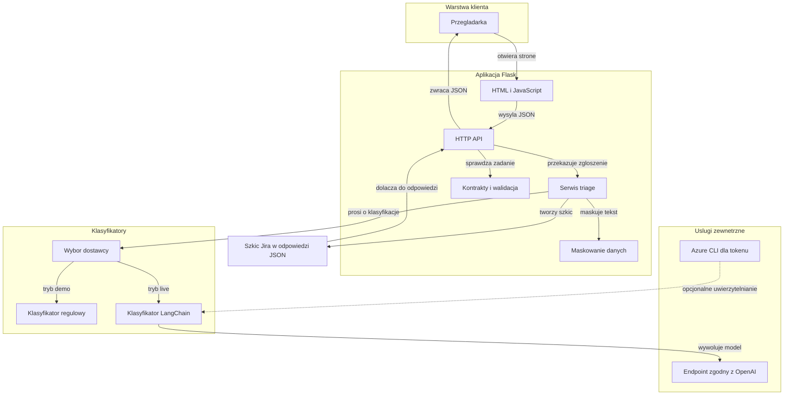
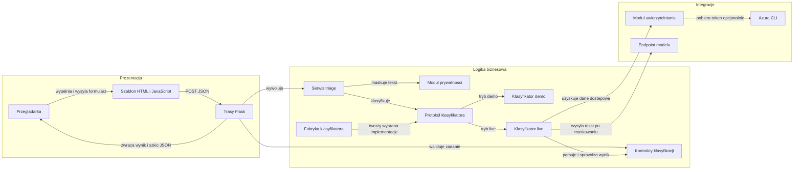

# Architecture Diagram

Projekt jest demonstracyjną aplikacją Flask do wstępnej klasyfikacji syntetycznych zgłoszeń. Przeglądarka wysyła tekst do API, które maskuje dane osobowe, korzysta z wybranego klasyfikatora i zwraca wynik wraz z lokalnym szkicem zgłoszenia.

## Application Architecture

<!-- mermaid-checked: no \n, no em-dash/en-dash, no {} in labels, subgraphs are id["label"], arrows are -->|"label"|, all subgraphs closed by end, ids unique -->

### Technology Stack Summary

| Warstwa | Technologia | Wersja | Przeznaczenie |
|---|---|---|---|
| Serwer WWW i API | Python, Flask | Python 3.11+; Flask 3.1.2 | Strona HTML, endpointy `/health` i `/api/triage` |
| Konfiguracja | python-dotenv | 1.2.2 | Wczytywanie ustawień z pliku `.env` |
| Klasyfikacja demo | Python | Wersja runtime | Deterministyczna klasyfikacja regułowa, domyślna |
| Klasyfikacja live | LangChain OpenAI | 1.6.7 | Wywołanie skonfigurowanego endpointu zgodnego z OpenAI |
| Uwierzytelnianie live | Azure Identity | 1.26.0 | Opcjonalne pobieranie tokenu przez Azure CLI |
| Interfejs | HTML, CSS, JavaScript | Bez frameworka | Formularz zgłoszenia i prezentacja odpowiedzi JSON |
| Testy | pytest | 9.0.2 | Testy API, kontraktów, prywatności, dostawców i ewaluacji |

### Data Storage & External Services

Aplikacja nie korzysta z bazy danych, cache ani brokera komunikatów. Wynik zawierający szkic Jira jest zwracany w odpowiedzi API; nie jest wysyłany do Jiry ani trwale zapisywany. W domyślnym trybie `demo` klasyfikacja odbywa się lokalnie. W trybie `live` zamaskowany tekst trafia do skonfigurowanego endpointu modelu zgodnego z OpenAI; uwierzytelnianie może korzystać z klucza API albo, opcjonalnie, z tokenu Azure CLI.

### Key Architectural Decisions

- Tryb klasyfikacji wybierany jest jawnie przez `TRIAGE_MODE`; błędna konfiguracja nie powoduje cichego przejścia na inny tryb.
- Logika triage korzysta z protokołu klasyfikatora, co pozwala podmieniać implementacje i wstrzykiwać je w testach.
- Dane osobowe są maskowane przed klasyfikacją i przed umieszczeniem uzasadnienia w odpowiedzi.

## Component Relationships

<!-- mermaid-checked: no \n, no em-dash/en-dash, no {} in labels, subgraphs are id["label"], arrows are -->|"label"|, all subgraphs closed by end, ids unique -->

### Component Inventory

| Komponent | Warstwa | Typ | Odpowiedzialnosc |
|---|---|---|---|
| Szablon HTML i JavaScript | Prezentacja | Interfejs WWW | Zbiera tekst i identyfikator sklepu, wysyła zadanie i pokazuje wynik |
| Trasy Flask | Prezentacja | Aplikacja HTTP | Obsługuje stronę, health check, walidację wejścia i odpowiedzi API |
| Serwis triage | Logika biznesowa | Serwis | Koordynuje maskowanie, klasyfikację, routing zespołu i szkic odpowiedzi |
| Moduł prywatności | Logika biznesowa | Transformacja danych | Maskuje adresy e-mail, numery telefonów i numery PESEL |
| Fabryka klasyfikatora | Logika biznesowa | Fabryka | Buduje klasyfikator zgodnie z konfiguracją trybu |
| Protokół klasyfikatora | Logika biznesowa | Interfejs | Definiuje wspólny tryb i operacje klasyfikacji |
| Klasyfikator demo | Logika biznesowa | Implementacja klasyfikatora | Klasyfikuje lokalnie według reguł i słownika |
| Klasyfikator live | Logika biznesowa | Implementacja klasyfikatora | Wysyła zamaskowany tekst do endpointu modelu i parsuje odpowiedź |
| Kontrakty klasyfikacji | Logika biznesowa | Walidacja danych | Sprawdza pola i dopuszczalne wartości wyniku modelu |
| Moduł uwierzytelniania | Integracje | Uwierzytelnianie | Dostarcza klucz API albo dostawcę tokenu Azure CLI |
| Endpoint modelu | Integracje | Zewnętrzna usługa | Klasyfikuje zgłoszenie w trybie live |
