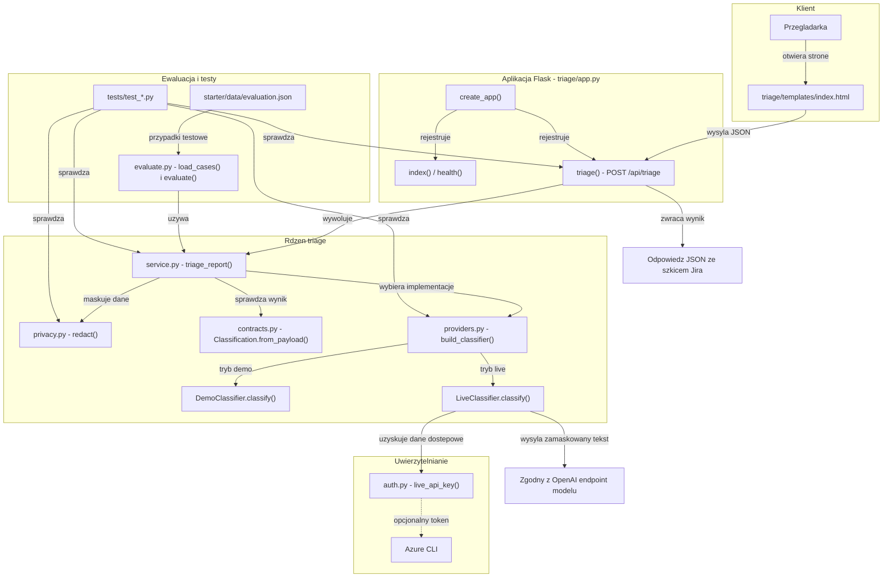

# Architektura projektu

Projekt jest warsztatową aplikacją Flask do klasyfikowania syntetycznych zgłoszeń. Główna ścieżka przetwarzania biegnie od formularza w przeglądarce przez API i serwis triage do lokalnego klasyfikatora demo lub skonfigurowanego endpointu modelu; ewaluacja i testy korzystają z tych samych modułów rdzenia.

<!-- mermaid-checked: no \n, no em-dash/en-dash, no {} in labels, subgraphs are id["label"], arrows are -->|"label"|, all subgraphs closed by end, ids unique -->

## Główne pliki i metody

| Plik | Kluczowe metody i elementy | Odpowiedzialność |
|---|---|---|
| `triage/app.py` | `create_app()`, `index()`, `health()`, `triage()` | Tworzy aplikację Flask, udostępnia stronę i health check, waliduje żądania API i mapuje błędy na odpowiedzi HTTP. |
| `triage/templates/index.html` | Obsługa `submit` formularza | Zbiera tekst i identyfikator sklepu, wysyła żądanie `POST /api/triage` i wyświetla odpowiedź. |
| `triage/service.py` | `triage_report()` | Koordynuje maskowanie, klasyfikację, walidację wyniku oraz przygotowanie szkicu Jira w odpowiedzi. |
| `triage/privacy.py` | `redact()` | Maskuje adresy e-mail, numery telefonów i numery PESEL. |
| `triage/providers.py` | `Classifier`, `DemoClassifier.classify()`, `LiveClassifier.classify()`, `build_classifier()` | Definiuje interfejs klasyfikatora, implementacje demo i live oraz wybór trybu przez konfigurację. |
| `triage/contracts.py` | `Classification.from_payload()` | Weryfikuje strukturę i dopuszczalne wartości klasyfikacji; definiuje typy wyniku i szkicu Jira. |
| `triage/auth.py` | `live_api_key()`, `main()` | Dostarcza klucz API albo token Azure CLI dla trybu live; nie stosuje automatycznego fallbacku. |
| `triage/evaluate.py` | `load_cases()`, `evaluate()`, `main()` | Wczytuje zbiór ewaluacyjny, uruchamia klasyfikację i wylicza metryki, w tym macro F1 i trafność priorytetu. |
| `starter/data/evaluation.json` | Przypadki z oczekiwaną kategorią i priorytetem | Zbiór danych używany przez lokalną ewaluację. |
| `tests/test_api.py`, `tests/test_contracts.py`, `tests/test_privacy.py`, `tests/test_providers.py`, `tests/test_auth.py`, `tests/test_evaluation.py` | Testy modułowe i API | Sprawdzają kontrakty, prywatność, uwierzytelnianie, dostawców klasyfikacji, endpointy oraz metryki. |
| `scripts/run.ps1`, `scripts/evaluate.ps1` | Uruchamianie aplikacji i ewaluacji | Zapewniają skrypty PowerShell do lokalnego uruchomienia aplikacji i zbioru ewaluacyjnego. |

## Przepływ i integracje

Endpoint `POST /api/triage` wymaga JSON z polami `text` i `store_id`. Serwis maskuje tekst przed przekazaniem go klasyfikatorowi, a wynik waliduje przez `Classification.from_payload()`. Kategoria `other` trafia do ręcznego przeglądu; pozostałe kategorie generują wyłącznie podgląd szkicu zgłoszenia, bez zapisu ani wysyłki do Jiry.

Domyślny tryb `demo` klasyfikuje lokalnie. Tryb `live` wysyła zamaskowany tekst do skonfigurowanego endpointu zgodnego z OpenAI; dostęp może być skonfigurowany kluczem API lub tokenem uzyskanym przez Azure CLI. Projekt nie używa bazy danych, cache ani brokera komunikatów.
